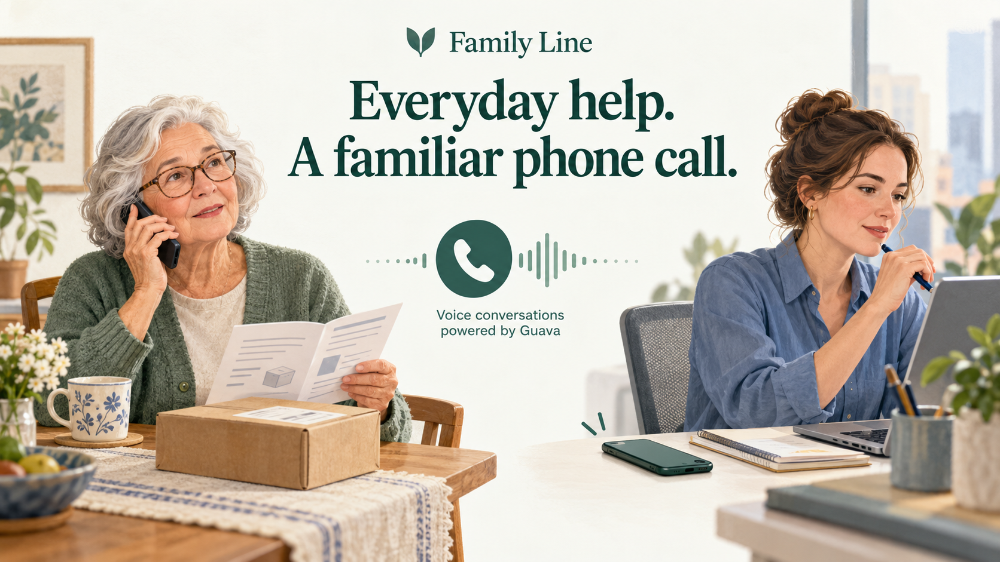
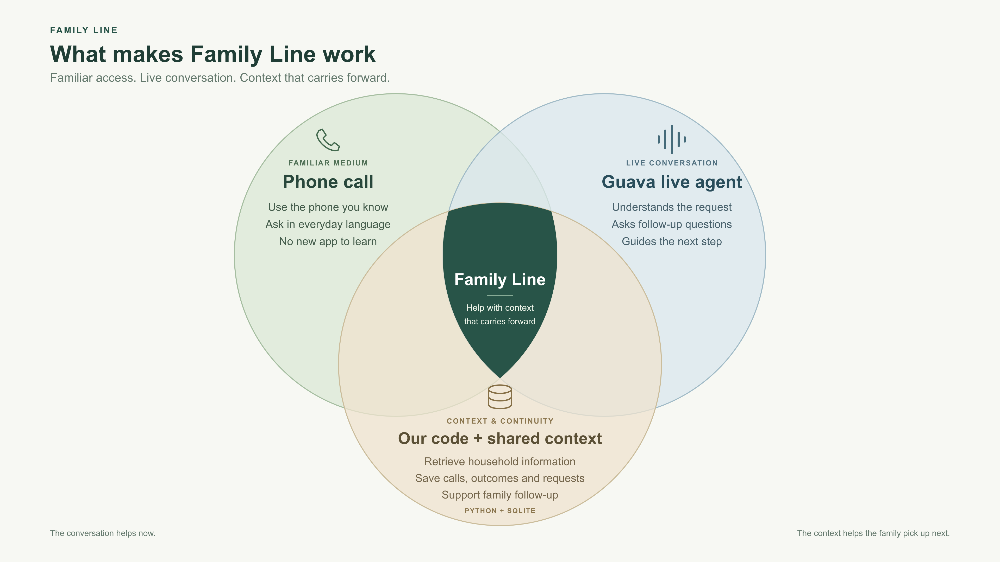

# Family Line

**Everyday help through a familiar phone call, with context the family can carry forward.**

Family Line connects what a family knows about home with an older relative’s questions. Family members prepare household information through a conversational dashboard. The older relative calls a Guava voice agent for guidance. Conversations and requests return to the dashboard so family members can understand what happened and pick up the next step.

**Case status:** presented and wrapped up on **October 17, 2026**, as confirmed by the project owner. This repository preserves the working local prototype, its design decisions, demonstration materials and verification notes. The demo video has not been supplied yet; its reserved location is [`demo/video/`](demo/video/README.md).



## Why we built it

A loved one needs help, and you cannot always answer. Even when you can, helping from a distance takes context: what they are looking at, what they have already tried and what information applies to their home. For some older relatives, navigating another app adds effort at the moment they need help.

Family Line uses the phone as a familiar entry point. Its value comes from combining a responsive conversation with concrete household information and a record that helps family members follow up. Television guidance is the demonstration case; the product idea is broader everyday family support.

## What is in the prototype

| Area | Implemented behavior |
|---|---|
| **Family assistant** | One conversation for typed messages, microphone transcription, photos, documents and public URLs. The assistant asks follow-up questions and prepares a handover for review. |
| **Reviewed household context** | Confirmed facts and source notes become available to calls. Original files remain accessible. Drafts from the conversation stay separate until confirmation. |
| **Guava phone agent** | Inbound conversation, fresh context lookup, clarifying questions, stepwise guidance, confirmed information changes and requests for family help. |
| **Overview** | Requests needing attention, latest call and transcript, ownership and response notes. History and secondary controls are collapsed. |
| **Persistence and reminders** | SQLite stores records, conversations, outcomes, follow-ups and scheduled jobs. Dashboard reminders are implemented. The outbound-phone job path exists but end-to-end outbound delivery has not been verified. |

See the [full feature inventory](docs/FEATURES.md) for behavior, evidence and limits.

## The demonstration case

The household is fictional: **June Hayes**, granddaughter **Emma Hayes**, and backup contact **Daniel Hayes**. Emma provides an actual licensed Roku remote photograph plus household notes. June can ask which remote to use and which button opens Netflix, then leave a request for Emma in the same call. The family sees the conversation and its request afterward.

The photo, household setup and observed screen state have different roles. The assistant can use the saved photo and setup; the caller supplies the current screen state. It does not operate or watch the television.

- [Case study and product decisions](docs/CASE_STUDY.md)
- [Reproduce the TV example](DEMO_WALKTHROUGH.md)
- [Source photo, license and notes](examples/tv-demo/source-notes.md)

## Run locally

Requires Python 3.11+ and `uv`; the original local demonstration used Python 3.12. Start from the repository root:

```sh
uv sync --locked
# On a clean checkout only: create the prepared fictional household.
uv run python scripts/prepare_demo.py --data-dir ./data
uv run python main.py
```

Open **http://127.0.0.1:8778/**. Complete the sample-family setup and use **Connections** to configure the OpenAI model/key for intake. Without an OpenAI key, saved records and the local dashboard remain available; AI intake requires a configured provider.

The preparation command refuses a nonempty directory. Keep existing `data/` if you are continuing the original demonstration. For a separate local copy:

```sh
uv run python scripts/prepare_demo.py --data-dir ./data/replay
FAMILY_DATA_DIR=./data/replay uv run python main.py --port 8779
```

For telephone access, configure your own Guava project/number and keep its real `guava.toml` local, then run:

```sh
guava run . -- --phone
```

The [runbook](RUNBOOK.md) covers Guava setup, provider settings, isolated data, optional checks and shutdown. `guava.toml.example` documents the configuration shape without the original account binding.

## How the system is divided



| Component | Responsibility |
|---|---|
| Browser dashboard | Family conversation, reviewed information, call history and follow-up UI. |
| OpenAI intake | Understand uploaded material, transcribe microphone input and propose structured updates. |
| Guava live agent | Conduct the phone conversation, interpret requests, ask follow-up questions and invoke registered actions. |
| Python / FastAPI | Retrieve context, validate writes, serve the UI and coordinate call records and reminders. |
| SQLite + local files | Persist approved facts, source notes, uploads, calls, requests, family responses and jobs. |

Retrieval uses structured records plus keyword-ranked source excerpts. This prototype does **not** use an embedding service or vector database. [Architecture, sequences and data model →](docs/ARCHITECTURE.md)

## Repository guide

```text
main.py                  Application entry point and phone/worker wiring
family/                  Backend, Guava agent, schema and browser UI
scripts/prepare_demo.py  Create a clean fictional TV setup without model calls
examples/tv-demo/        Licensed remote photo and household/source notes
artifacts/               Presentation images, editable diagrams and screenshots
README.md                Current project entry point
RUNBOOK.md               Setup and operating instructions
USER_FLOW.md             Product workflow and two-sided dashboard rationale
docs/                    Architecture, features, case study and project history
demo/video/              Reserved folder for the final demo recording
tests/                   Isolated local tests
main.todo.py             Earlier todo-learning prototype
main.original.py         Original scaffold retained for reference
```

Presentation files remain at their existing paths so earlier links keep working:

- [Solo presentation, including optional future vision](PRESENTATION_SCRIPT.md)
- [Four-minute video, narration, screen plan and caller lines](VIDEO_SCRIPT_4MIN.md)
- [Product workflow PNG](artifacts/family-line-user-flow.png) / [editable SVG](artifacts/family-line-user-flow.svg)
- [All images and their purpose](artifacts/README.md)
- [Historical exploration and decisions](docs/history/PROJECT_LOG.md)
- [Initial version plan — historical](FIRST_VERSION.md)

## Scope and evidence

The project owner confirmed that the presentation was completed. Earlier work recorded a successful user phone call, real OpenAI photo-to-handover checks and Guava text-integration checks. These are prototype checks, not user-research findings or proof of production reliability. Current wrap-up checks are documented in [verification notes](docs/VERIFICATION.md).

The app is a local, single-household prototype. Role selection is not authentication. Multi-user accounts, live carrier tracking, Apple Watch integration, smart-home control and automatic family escalation are future directions. Parcel-status examples are simulated. Outbound reminder code does not establish successful receipt or task completion.

API keys, `guava.toml`, uploads and the live SQLite database are excluded from Git. The fictional fixture can be recreated without exporting real call history. This local app is not a production deployment.

> So instead of just a missed call, the family now has concrete context: what came up, what was tried, and where their help is needed.
