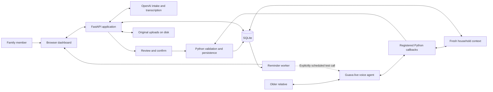
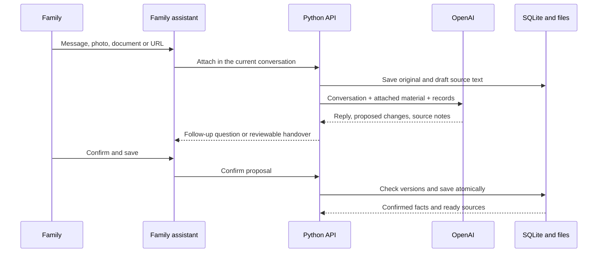
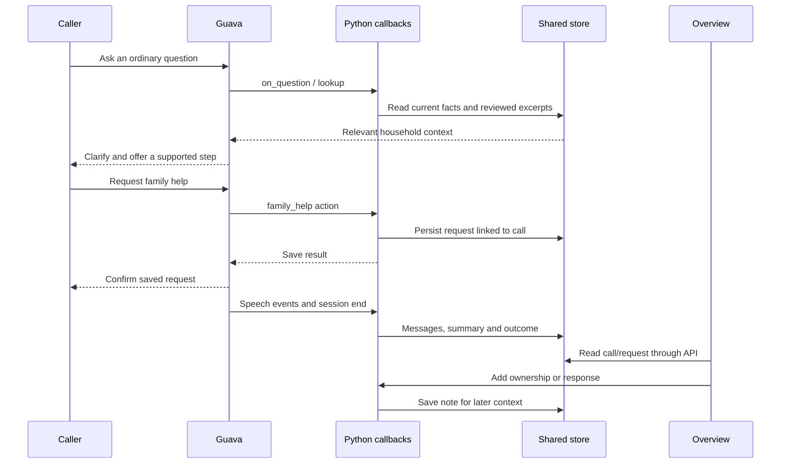
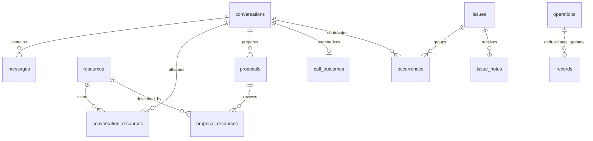

# System architecture

Family Line is one local Python application with an English browser dashboard, a Guava phone agent and a shared SQLite store. The interface is served by FastAPI; no separate frontend build step is required.

## Component responsibilities

The components are responsibilities, not separate deployed microservices. `main.py` starts FastAPI and a reminder thread; phone mode adds a Guava listener thread and a dial function.

- **Guava** supplies live voice interaction, intent/task handling and helper-model requests. It invokes our callbacks; a verbal intention is not a database write.
- **OpenAI** is the separately configured provider for family-side intake, image/scanned-PDF interpretation and microphone transcription.
- **Our code** retrieves context, validates proposals, performs transactions, records calls and requests, and serves the family view.

## Intake and review

The main conversation flow marks attachments for review. Confirmation saves records and source notes in one transaction; stale proposals fail visibly. The API also retains manual record/resource review routes. Provider failures are surfaced rather than replaced with fabricated model output.

## Phone and family follow-up

The agent asks for current observations. A stored household setup cannot establish the present television screen. A request in the dashboard is not an outbound call, and a dialing attempt is not evidence that someone answered.

## Retrieval

`store.context(query)` combines the household profile, all active structured records, recent jobs, recent family issue notes and up to eight keyword-ranked source excerpts from `ready` resources. Source text is split into overlapping chunks. Long record bodies are truncated and marked as excerpted. Returned excerpts include resource IDs, titles and offsets.

This is lightweight retrieval over reviewed information, not embedding-based RAG. Draft conversation material and all raw historical call transcripts are not automatically inserted into every prompt. Saved family response notes provide the continuity between calls.

## Data model

Solid relations are represented by foreign-key columns; dotted relations are application-level associations rather than schema constraints. `proposals.changes` stores proposed record operations as JSON. `operations` stores idempotency keys/results; it has no physical relation table to `records`.

| Table / store | Purpose |
|---|---|
| `records` | Versioned devices, people, places, preferences, routines, notes and legacy delivery fixtures. |
| `resources` | Original file path or URL, extracted/reviewed text, processing state and errors. |
| `conversations`, `messages` | Channel, caller role, lifecycle and individual utterances. |
| `proposals`, `proposal_resources` | Proposed record changes and reviewed source text with stale-update checks. |
| `issues`, `occurrences`, `issue_notes` | Grouped requests, supporting calls, ownership and family responses. |
| `call_outcomes` | Structured outcome and summary for one conversation. |
| `jobs` | Due time, mode, payload, execution state, attempts and deduplication key. |
| `settings`, `operations` | Household/nonsecret settings and confirmed-operation results. |
| `data/uploads/` | Original uploaded or fetched material. |
| `data/.provider.json` | Local provider credential/model file, mode 0600; excluded from Git and API responses. |

## Runtime and repository boundaries

`FAMILY_DATA_DIR` selects the database/upload/config directory. The default is `<project>/data`. Tests use temporary directories. The dashboard binds to `127.0.0.1`; host/origin checks and the local-client header constrain browser requests, but this is not a multi-user authentication system.

The simple worker claims one due job at a time. Restarted in-flight jobs become interrupted rather than automatically redialed. Phone-mode jobs require a configured test recipient. Shared account credentials, live data and recordings are not embedded in the source repository.

The original `guava.toml` remains local. [`guava.toml.example`](../guava.toml.example) is a reference shape; another user needs their own Guava project and number.

## Source map

- [`main.py`](../main.py): entry point, listener and worker wiring.
- [`family/phone.py`](../family/phone.py): Guava event/action handlers.
- [`family/intelligence.py`](../family/intelligence.py): OpenAI intake and media understanding.
- [`family/web.py`](../family/web.py): API and browser safety checks.
- [`family/resources.py`](../family/resources.py): parsing and public URL fetching.
- [`family/store.py`](../family/store.py) / [`schema.sql`](../family/schema.sql): queries, writes and tables.
- [`family/static/`](../family/static/): plain HTML/CSS/JavaScript interface.
- [`family/worker.py`](../family/worker.py): reminders.
